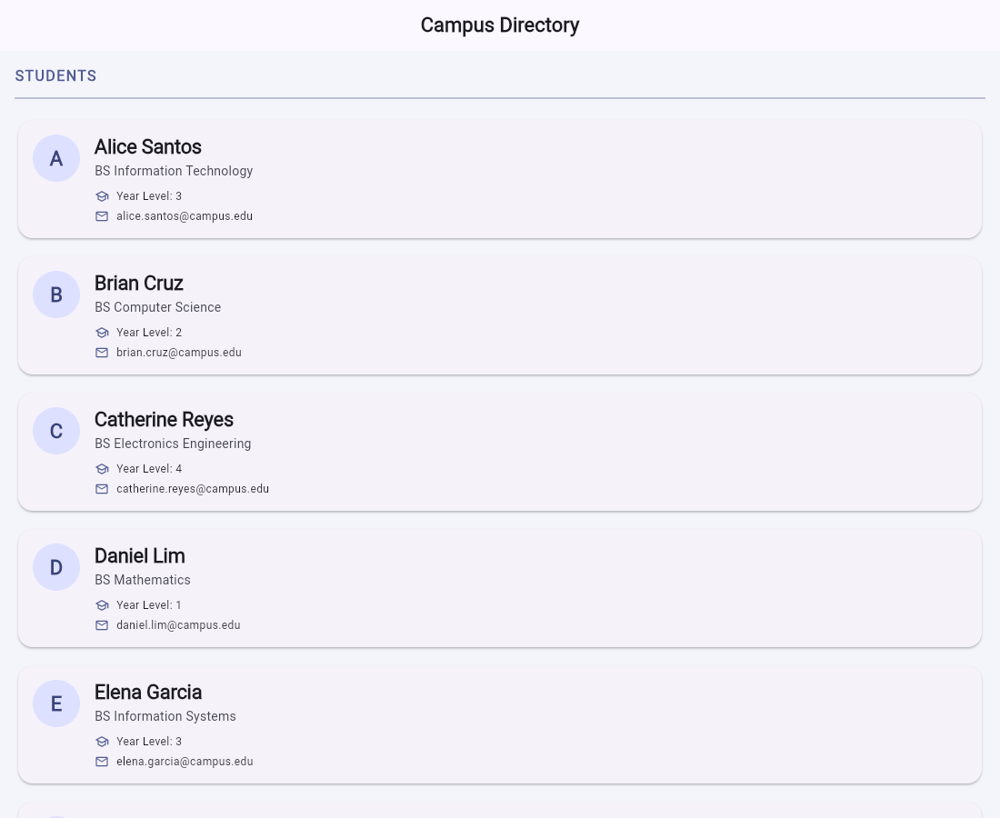

# Stateless Lab — Campus Student Directory

**Name:** Jay Aguelo (`aguelo`)
**Activity:** StatelessWidget Lab — Campus Student Directory
**Framework:** Flutter (Material 3)



## About

A one-screen Flutter app that shows a directory of students. The screen is composed
from small, reusable `StatelessWidget` classes that receive all of their data through
constructors. Nothing on the screen changes by itself, so the app uses no
`StatefulWidget` and no `setState` — when the data changes, the parent rebuilds its
children with the new values.

## Widgets

| Widget | Responsibility |
| --- | --- |
| `Student` | Immutable data class (`final` fields, `const` constructor) |
| `DirectoryApp` | `MaterialApp` with the Material 3 theme (indigo color seed) |
| `DirectoryScreen` | `Scaffold` with the `Campus Directory` `AppBar` and a `ListView` |
| `SectionHeader` | Bold, colored heading with a `Divider` below it |
| `StudentCard` | `Card` with a `CircleAvatar`, name, course and two `InfoRow`s |
| `InfoRow` | An icon and a text label side by side in a `Row` |

## Style customizations

1. Indigo `colorSchemeSeed` for the app theme.
2. Tinted scaffold background so the cards stand out.
3. Uppercase, letter-spaced section heading in the primary color.
4. Thicker divider tinted with the primary color.
5. 16 px rounded corners on the student cards.
6. `CircleAvatar` using `primaryContainer` with the student's first letter.
7. Bold, tightly letter-spaced name style for the card headline.

## Run it

```bash
flutter pub get
flutter run   # pick Chrome, an emulator, or a device
```
